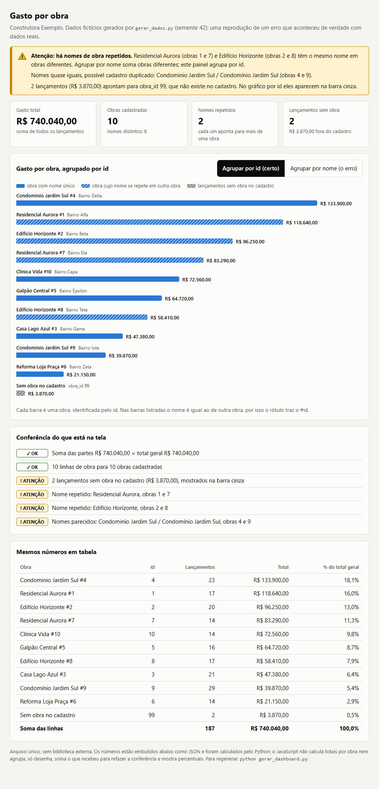
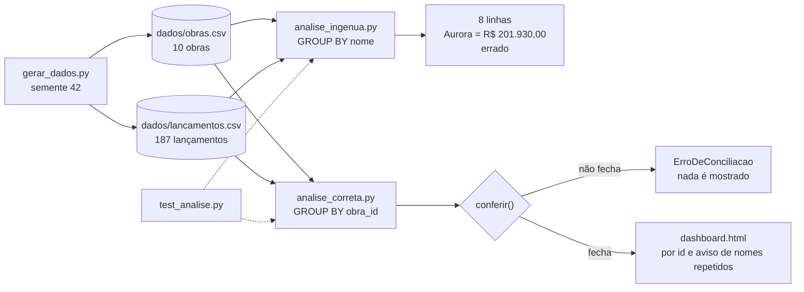
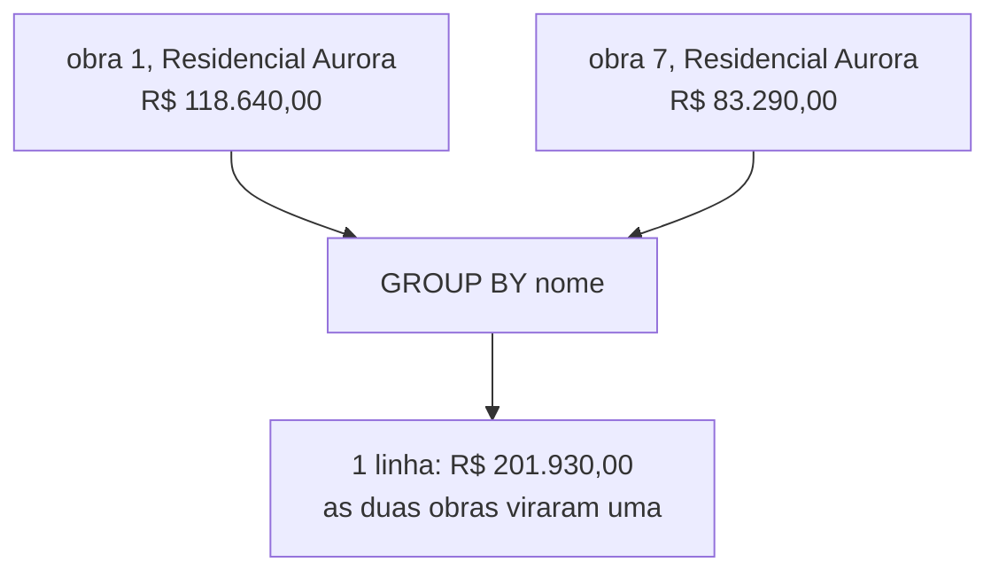

# Análise de dados com IA: o dia em que a IA somou por nome e não por id

Reprodução, com dados fictícios, de um erro real: um painel de obras em que a IA juntou duas obras de nome igual ou parecido, mais um método de conferência que pega o erro antes de o número chegar a quem decide.

## Problema

Num sistema de gestão de uma construtora, a IA montou um painel (dashboard) de obras. O total apareceu bem acima do valor real. A causa: a IA agrupou os lançamentos pelo **nome** da obra e não pelo **id**, e obras diferentes tinham o mesmo nome ou nomes parecidos. Para o código, as de nome igual viraram uma só. Não sei dizer se os nomes reais eram idênticos ou só parecidos; a reprodução usa nomes idênticos (Residencial Aurora) e um par que só difere no acento (que o agrupamento por nome NÃO junta, mas a conferência avisa). Também não sei qual variante do erro ocorreu: se o total do painel inflou porque a junção foi feita pelo nome (linhas duplicadas) ou se só a linha de uma obra passou a mostrar a soma de duas. A reprodução cobre apenas o segundo caso, o agrupamento por nome depois de juntar por id. A conferência deste repositório é a da reprodução.

O que torna esse erro perigoso:

- a consulta roda sem erro e devolve números plausíveis;
- juntar duas obras no agrupamento não muda a soma. Isso vale só para a variante reproduzida aqui (junção por id, agrupamento por nome); no caso real, se a junção tiver sido feita pelo nome, o total pode ter inflado. Na reprodução a soma das linhas ainda destoa em R$ 3.870,00, mas só por causa dos lançamentos sem obra. Sem esses lançamentos o total fecharia e só a contagem de linhas contra as obras cadastradas acusaria o erro;
- em geral quem usa o painel vê o gráfico, não a consulta.

Dados, nomes e valores reais não estão aqui, nem a consulta exata que o modelo escreveu. O que está aqui é uma reprodução do mesmo mecanismo com dados 100% inventados da "Construtora Exemplo". Na reprodução, a linha da obra repetida mostra R$ 201.930,00.

## Solução

Três peças pequenas, só com a biblioteca padrão do Python:

1. **Os dois métodos lado a lado.** `analise_ingenua.py` agrupa por nome (o erro). `analise_correta.py` agrupa por `obra_id`.
2. **Conferências que recusam o resultado.** `conferir()` levanta `ErroDeConciliacao` se a soma das partes não bater com o total geral, se o número de linhas não for igual ao de obras cadastradas, ou se um `obra_id` se repetir no cadastro. Também avisa de lançamentos sem obra, nomes repetidos e nomes que só diferem no acento.
3. **Testes que provam as conferências.** Quatro regras valem para qualquer método. O correto passa nas quatro; o ingênuo falha nas quatro. A da soma falha só por causa dos lançamentos sem obra. A do total de cada obra falha porque o agrupamento por nome descarta o `obra_id`. As outras duas (uma linha por obra cadastrada e obras de mesmo nome separadas) falham por causa da junção por nome. A conferência vai um passo além do total: conta também as linhas contra as obras cadastradas.

Além disso, `dashboard.html` mostra o resultado com um aviso visível quando há nome repetido, e tem um botão para alternar entre "agrupar por id" e "agrupar por nome (o erro)". Em [prompts/analise-com-ia.md](prompts/analise-com-ia.md) há um prompt reutilizável e um checklist para validar resposta de IA em análise de dados. Lições e limites do que foi provado: [docs/licoes.md](docs/licoes.md).



Mesmo painel agrupado por nome, que é o erro: [img/dashboard-por-nome.png](img/dashboard-por-nome.png).

## Diagrama



O mecanismo do erro, em três caixas:



## Stack

Python 3.12 (só biblioteca padrão: `csv`, `decimal`, `unittest`, `json`) · HTML, CSS e JavaScript puro com SVG inline (sem biblioteca e sem CDN). Dinheiro em `Decimal`, nunca em `float`.

## Resultado

Medido por mim em 28/10/2026 (Windows 10, Python 3.12.10, Edge 155 em modo headless), rodando os comandos da seção "Como rodar"; as linhas "Teste de mutação" e "Dashboard" (console e 375 px) são verificações manuais descritas na própria linha:

| Verificação | Resultado |
|---|---|
| Dados gerados (semente 42) | 10 obras e 187 lançamentos; 2 lançamentos apontam para a obra 99, que não existe no cadastro |
| Total geral (`sum` de todos os lançamentos) | R$ 740.040,00 |
| Total de cada obra conferido por fora do Python | bate com `awk` sobre o CSV, obra por obra |
| Método ingênuo (por nome) | 8 linhas para 10 obras; "Residencial Aurora" mostra R$ 201.930,00, que é R$ 118.640,00 (obra 1) + R$ 83.290,00 (obra 7) |
| Método ingênuo, soma das linhas | R$ 736.170,00: não fecha com o total, porque o `JOIN` comum descarta em silêncio os R$ 3.870,00 sem obra |
| Método correto (por id) | 10 linhas de obra + 1 linha de lançamentos sem obra; soma das partes = total geral |
| `python -m unittest` | 20 testes: 16 passam e 4 são falhas esperadas (as do método ingênuo). Resultado: `OK (expected failures=4)` |
| `VER_FALHAS=1 python -m unittest` | as 4 regras falham no método ingênuo (`FAILED (failures=4)`) |
| Teste de mutação, numa cópia temporária | em `totais_por_obra` do `analise_correta.py`, somei pelo nome da obra no lugar de `obra_id` e mantive uma linha por nome (com o id da primeira): 3 testes falharam e 2 deram erro (o `setUpClass` da `TestConferencia`, onde `conferir()` recusa o resultado, e o teste do dashboard). Desligar só a checagem de contagem de linhas em `conferir()` faz 1 teste falhar; desligar só a de soma, também 1 |
| Dashboard | 21,5 KB, arquivo único, sem referência a recurso externo (teste automatizado de `src`/`href` (com `http:`, `https:` ou sem protocolo, `//`), `@import`, `url(http`, `fetch` e `XMLHttpRequest`); sem erro no console ao abrir e ao alternar para "por nome"; sem rolagem horizontal da página em 375 px de largura (janela emulada num navegador embutido baseado em Chromium, não o Edge 155 headless e não um celular real) |
| Tamanho do código | 474 linhas de Python (`wc -l *.py`) e 303 do modelo do dashboard |

Os números do caso real (diferença mostrada, tempo até perceber o erro, painéis com conferência automática) não foram medidos aqui.

## Como rodar

Precisa só de Python 3.12 (o único que testei: 3.12.10). Dentro da pasta do projeto:

```bash
python gerar_dados.py          # regera dados/obras.csv e dados/lancamentos.csv (semente 42)
python analise_ingenua.py      # o erro: agrupa por nome
python analise_correta.py      # o certo: agrupa por id e imprime as conferências
python gerar_dashboard.py      # regera dashboard.html
python -m unittest -v          # 20 testes
```

4 dos 20 testes são falhas esperadas do método ingênuo; veja-as vermelhas com `VER_FALHAS=1`, logo abaixo.

Para ver as falhas do método ingênuo em vez de "falha esperada":

No bash:

```bash
VER_FALHAS=1 python -m unittest
```

No PowerShell (a última parte limpa a variável, para o próximo `python -m unittest` voltar ao normal):

```powershell
$env:VER_FALHAS=1; python -m unittest; Remove-Item Env:VER_FALHAS
```

Abra `dashboard.html` direto no navegador (duplo clique).

Escrevi e testei no Windows com Git Bash. Em Linux/macOS use `python3` no lugar de `python`. Se os acentos saírem quebrados no terminal: no bash, `PYTHONUTF8=1 python analise_correta.py`; no PowerShell, `$env:PYTHONUTF8=1` antes do comando.

Conferir um total sem Python, como na checagem manual (obra 7):

```bash
awk -F, 'NR>1 && $2==7 {s+=$7*100} END {printf "%.2f\n", s/100}' dados/lancamentos.csv   # 83290.00
```

## Estrutura de pastas

```
analise-dados-ia/
├── README.md
├── LICENSE                 # MIT
├── .gitignore
├── gerar_dados.py          # gera os CSVs fictícios (semente fixa)
├── analise_ingenua.py      # agrupa por nome: o erro
├── analise_correta.py      # agrupa por id + conferir()
├── gerar_dashboard.py      # monta dashboard.html com o JSON embutido
├── dashboard_modelo.html   # molde do dashboard (placeholder __DADOS__)
├── dashboard.html          # saída: arquivo único, sem CDN
├── test_analise.py         # testes (unittest)
├── util.py                 # leitura dos CSVs e formatação em reais
├── dados/
│   ├── obras.csv
│   └── lancamentos.csv
├── prompts/
│   └── analise-com-ia.md   # prompt reutilizável + checklist de validação
├── docs/
│   └── licoes.md
└── img/                    # capturas do dashboard
```

## Decisões de projeto

- **Dados com total conhecido de antemão.** O gerador sorteia os lançamentos de cada obra, mas o último absorve a diferença de centavos, então o total de cada obra é um número fixo (`ESPERADO` nos testes). Isso permite conferir na mão, que é o que um teste de análise de dados precisa. Troca: os valores têm cara de sorteio, não de obra de verdade.
- **Duas famílias de conferência.** O que invalida o resultado levanta exceção (soma não fecha, linhas diferentes de obras, id repetido). O que só merece olho humano vira aviso (lançamento sem obra, nome repetido). Misturar as duas faria o aviso virar ruído ou o erro virar aviso.
- **Contar linhas além de somar.** O teste `test_recusa_obras_juntadas_mesmo_com_a_soma_certa` junta as duas "Aurora" na mão: a soma continua igual e só a contagem de linhas contra obras cadastradas acusa. Foi a lição mais importante.
- **Lançamento sem obra ganha linha própria.** Em vez de sumir num `JOIN`, aparece como "(sem obra no cadastro)". Assim a soma das partes inclui tudo e o buraco fica visível.
- **O ingênuo está de propósito no repositório.** É o contraexemplo que faz os testes e o dashboard mostrarem o erro. Os testes dele usam `expectedFailure`: a suíte fica verde e prova que as quatro regras pegam o erro.
- **O JavaScript do dashboard não calcula os totais por obra nem agrupa.** Os números vêm do Python como JSON embutido; o JS só soma o que o Python entregou para refazer a conferência e mostrar percentuais. Troca: a lógica da conferência existe em dois lugares, o que é redundância de propósito.
- **Aviso e legenda sem depender só de cor.** Barra de nome repetido tem listra, o selo de erro tem ícone e texto, e a tabela traz os mesmos números.
- **Biblioteca padrão e CSV.** O sistema real usa PostgreSQL, mas o erro não depende do banco: depende da chave de agrupamento. CSV e `csv`/`decimal` bastam para reproduzir e deixam qualquer pessoa rodar sem instalar nada.

## Limitações / o que ficou de fora

- É uma **reprodução**. Não há dado, consulta nem código do sistema real aqui. A consulta ingênua é a forma típica do erro, escrita por mim.
- A reprodução cobre só uma variante do erro: agrupar por nome depois de juntar por id. Não sei se, no caso real, o total do painel inflou por junção pelo nome (linhas duplicadas) ou se só a linha de uma obra mostrou a soma de duas; essa variante que infla o total não está reproduzida aqui.
- **Não rodei nenhum prompt contra nenhum modelo** neste repositório. O que está provado é o método de conferência em código. O prompt e o checklist em `prompts/` são a consequência prática da lição, não um resultado medido.
- A detecção de nomes parecidos só normaliza acento, caixa e espaço. "Res. Aurora" ou erro de digitação passam.
- O dashboard é estático: sem filtro de período e sem atualização ao vivo. Para mudar os números, rode `gerar_dashboard.py`.
- Os testes cobrem este conjunto de dados. Outro conjunto exige revisar `ESPERADO`.
- Testado só em Windows 10 com Python 3.12.10 e Edge 155; o teste de 375 px foi em viewport emulado.

## Como foi feito

O incidente é real e o relato dele é da memória do autor, sem registro aqui; os dados são inventados. Os números da reprodução saíram da execução dos comandos acima e das verificações manuais descritas em "Resultado"; os do caso real não foram medidos aqui.

## Licença

MIT. Copyright (c) 2026 Rafael M. da Silva Santos. Veja [LICENSE](LICENSE).
